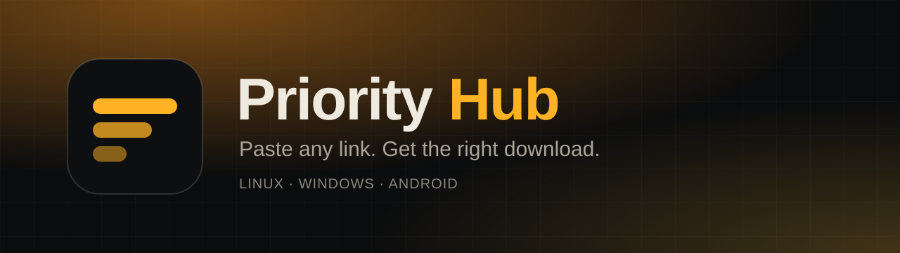

<p align="center">
  
</p>

<p align="center">
  <a href="https://github.com/vancored/priority-hub/releases/latest"></a>
  <a href="LICENSE"></a>
  
  
  
</p>

<h3 align="center">Paste a link. Priority Hub finds the right download, puts it where you want it, and keeps it up to date.</h3>

---

## Download

Grab the file for your system from the [latest release](https://github.com/vancored/priority-hub/releases/latest):

| Platform | File | Notes |
| --- | --- | --- |
| 🐧 **Linux** (x86_64) | [`Priority-Hub-1.1.0-x86_64.AppImage`](https://github.com/vancored/priority-hub/releases/latest/download/Priority-Hub-1.1.0-x86_64.AppImage) | Make it executable and run it |
| 🪟 **Windows** installer | [`Priority-Hub-1.1.0-Setup.exe`](https://github.com/vancored/priority-hub/releases/latest/download/Priority-Hub-1.1.0-Setup.exe) | Per-user install, you choose the folder |
| 🪟 **Windows** portable | [`Priority-Hub-1.1.0-portable.exe`](https://github.com/vancored/priority-hub/releases/latest/download/Priority-Hub-1.1.0-portable.exe) | No installation needed |
| 🤖 **Android** 6.0+ | [`Priority-Hub-1.1.0-android.apk`](https://github.com/vancored/priority-hub/releases/latest/download/Priority-Hub-1.1.0-android.apk) | Allow “install unknown apps” |

Every release also ships a `SHA256SUMS.txt` so you can verify your download.

## What it does

- **First-run setup assistant.** An animated wizard walks you through language, default folders, options and an optional GitHub token. You can run it again from Settings.
- **16 languages.** Spanish, English, Portuguese, French, German, Italian, Dutch, Polish, Russian, Ukrainian, Turkish, Chinese, Japanese, Korean, Arabic (right-to-left) and Hindi. The language is detected from your system and can be changed any time.
- **Updates itself.** Every time you open the app it checks this repository for a new release and offers to update (Linux AppImage, Windows installer/portable, Android APK).
- **Paste anything.** A repository, a project web page, or a direct file link — Priority Hub scans it and lists every download it can find.
- **Picks the right file.** Results are ranked for *your* operating system and CPU architecture. Incompatible files are hidden behind an “All” filter.
- **You choose where it goes.** Pick the destination folder for every download, remember it per file type, or set defaults in Settings.
- **Works with many sites.** GitHub, GitLab (including self-hosted), Codeberg / Gitea / Forgejo, Bitbucket, SourceForge, direct links and arbitrary web pages.
- **Many file types.**
  - Linux: AppImage, `.sh`, `.py`, `.run`, Arch packages, Flatpak, binaries, archives, `.jar`, `.deb`, `.rpm`, `.snap`
  - Windows: `.exe`, `.msi`, `.bat`, `.cmd`, `.ps1`, `.py`, `.zip`, `.jar`
  - Android: `.apk` and archives
- **Keeps your apps updated.** Installed items are checked for new versions and can update themselves.
- **Watches pages for you.** Mark any page with *Watch changes* and get a notice when something new shows up.
- **Launcher entries.** Optional application-menu entry on Linux (with the project’s icon) and Start Menu shortcut on Windows.
- **Visible actions.** *View location* and *Delete* are always one click away on every item.

## Safety first

- Scripts, installers and packages are **never run automatically**. Priority Hub shows the script’s contents and flags risky patterns before anything runs in a terminal.
- SHA-256 checksums published next to a download are verified automatically.
- On Linux, icons are extracted from AppImages **without executing them**.
- Everything stays on your device: the library, watch list and settings live in a local file.

## Install

### Linux

```sh
chmod +x Priority-Hub-1.1.0-x86_64.AppImage
./Priority-Hub-1.1.0-x86_64.AppImage
```

If it does not start, your system may be missing FUSE 2 (`sudo pacman -S fuse2` on Arch, `sudo apt install libfuse2` on Debian/Ubuntu), or run it with `--appimage-extract-and-run`.
Optional: install `p7zip` so application-menu icons can be extracted from AppImages.

### Windows

Run `Priority-Hub-1.1.0-Setup.exe` (installer) or `Priority-Hub-1.1.0-portable.exe`.
The executables are not code-signed yet, so SmartScreen may warn you: choose **More info → Run anyway**.

### Android

Open the `.apk` and, when asked, allow your browser or file manager to install unknown apps. The APK is signed with the project’s own key, so Play Protect may ask for confirmation. Downloads are saved to the app folder or to any folder you pick with the system folder picker.

## Good to know

- Update checks and page watching run while the app is open. GitHub allows 60 anonymous API requests per hour — add a personal access token (no scopes needed) in **Settings** if you watch several pages.
- Self-update needs a published release in this repository. The Linux AppImage replaces itself in place; the Windows installer is launched for you; Android opens the system installer.
- Data location: `~/.config/priority-hub/` on Linux, `%APPDATA%\priority-hub\` on Windows.

## License

[MIT](LICENSE) © 2026 rike
